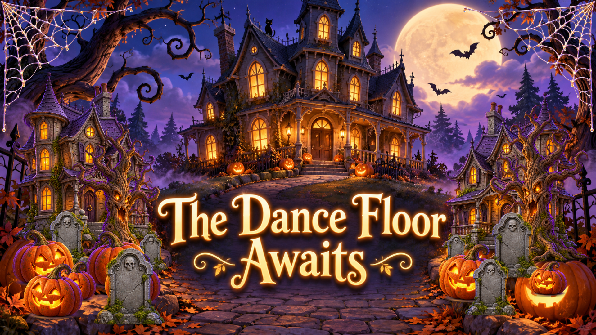
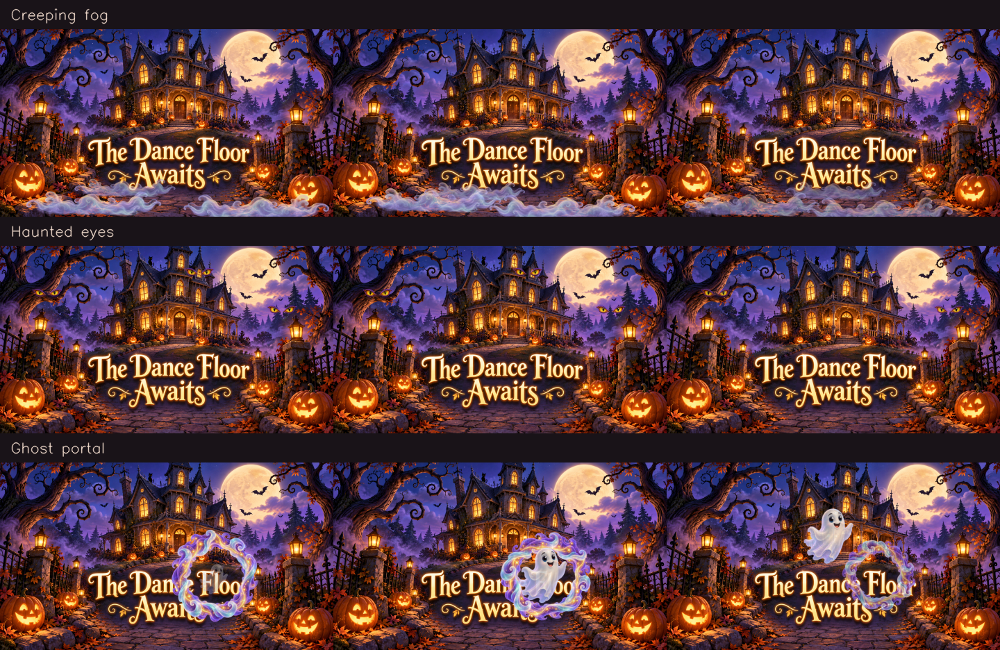
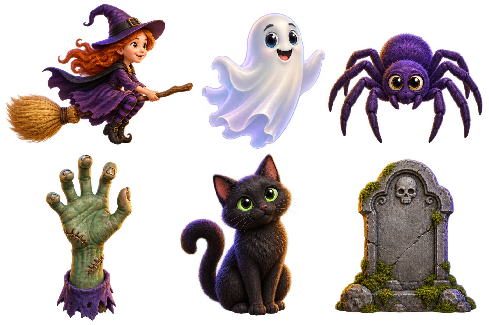

# Afterdark — Halloween Dance Display

Project location: `/home/kitchen/ai-projects/interactive-halloween`. The `afterdark-display` user service launches `run.sh` from this directory.

A Linux-first, local Python application that turns an RGB webcam into an interactive Halloween dance floor. The operator uses a browser on display 1; an independent Pygame/SDL window presents the camera and effects on display 2. No cloud service, browser camera permission, account, or depth camera is required.

Implemented: camera capture and reconnect, MediaPipe multi-pose tracking and person segmentation, stable internal IDs, gesture detection, ten effects, ten live cue animations, five scenes, per-person effect assignments, WebSocket control, live composite preview, fullscreen output, optional sounds, and an explicit synthetic rehearsal mode.

## Visual gallery

### Randomized Halloween scenery

Haunted houses, spooky trees, graves, jack-o’-lanterns, and optional corner webs.
Choose object counts in the controller and generate a new layout while keeping
space open for dancing. This rendered example uses the standby background, not
live camera footage.



### Animated atmosphere

Creeping fog, haunted eyes, and a ghost portal, shown at three stages of their
animations. These are rendered artwork previews, not camera captures.



### Original visitor artwork

The witch, ghost, spider, zombie hand, cat, and gravestone establish the visual
style used throughout the show.



## Quick start

```bash
./run.sh
```

Open **http://localhost:8000**. The camera starts automatically. Click **Start projector** separately. The default projector is monitor **1** (zero-based: the second display).

On a single-monitor computer:

```bash
PROJECTOR_MONITOR=0 ./run.sh
```

For rehearsal without a webcam:

```bash
PROJECTOR_MONITOR=0 ./run.sh --demo
```

The brief specified both ports 7750 and 8000. **8000 is the default**, following its Startup section. To use 7750:

```bash
PORT=7750 ./run.sh
# or
./run.sh --port 7750
```

Do not run two copies on the same port or with the same webcam. Press Ctrl+C in the application terminal to close the server, camera, and projector.

### Current background service

The dashboard can run as a temporary `systemd --user` service named `afterdark-display`, independent of the terminal that launched it. The current service starts with the camera stopped. It is not enabled at boot and ends with the user session.

```bash
systemctl --user status afterdark-display
systemctl --user restart afterdark-display
systemctl --user stop afterdark-display
journalctl --user -u afterdark-display -f
```

Stop this service before launching `./run.sh` manually on the same port. Once stopped, the temporary unit is collected; use `./run.sh` to start again, or create a new temporary service from the project directory:

```bash
systemd-run --user --collect --unit=afterdark-display \
  --property="WorkingDirectory=$PWD" \
  --setenv=AUTO_START_CAMERA=false \
  --setenv="DISPLAY=${DISPLAY:-:0}" \
  --setenv="WAYLAND_DISPLAY=${WAYLAND_DISPLAY:-wayland-0}" \
  "$PWD/run.sh"
```

## Prerequisites and Linux installation

- Python **3.11+**. Python 3.11 is the tested interpreter; use 3.11 or 3.12 for the most predictable wheel availability.
- Linux x86_64 with glibc 2.28+ for the pinned MediaPipe binary. ARM64/Raspberry Pi needs a compatible MediaPipe build and has not been validated.
- An RGB UVC webcam, an X11 or Wayland graphical session, and an extended desktop for two displays.
- Internet during the initial package/model installation only. Runtime, UI, assets, and inference are local.

Ubuntu/Debian system dependencies (package names may vary by distro):

```bash
sudo apt update
sudo apt install python3 python3-venv python3-pip libgl1 libglib2.0-0 libportaudio2 libsdl2-2.0-0
# Optional diagnostics:
sudo apt install v4l-utils x11-xserver-utils
```

If the distro's Python is older than 3.11, install a supported Python through your distro or a trusted Python version manager, then set `PYTHON_BIN=python3.11` when running setup. Fedora equivalents include `python3`, `python3-pip`, `mesa-libGL`, `glib2`, `portaudio`, `SDL2`, and `v4l-utils`.

MediaPipe imports `sounddevice` even for vision tasks, so PortAudio must initialize successfully. An inaccessible PulseAudio/PipeWire session can prevent MediaPipe from importing inside a sandbox/container. Run from the logged-in desktop session; missing **cue files** are harmless, but a broken native audio library can still affect MediaPipe initialization.

### Automatic setup

`run.sh` uses or creates `.venv`, checks the exact direct dependency versions without contacting a package index, installs missing/mismatched dependencies, downloads the official pose model if absent, and starts one FastAPI process plus its processing thread. It uses `uv` when available and standard `venv`/`pip` otherwise. It never starts the projector automatically.

```bash
./run.sh --setup
# Disconnect the network after this succeeds:
./run.sh
```

The versioned 5.8 MB MediaPipe lite model is downloaded from Google's official storage and checked against a SHA-256 digest. There is **no model download inside the runtime**. For offline deployment, transfer the installed model and install package wheels ahead of time. If a custom `MODEL_PATH` is used, place a compatible Pose Landmarker `.task` model there. Do not copy virtual environments between incompatible Linux/Python installations.

### Manual virtual environment setup

```bash
python3.11 -m venv .venv
source .venv/bin/activate
python -m pip install -r requirements.txt
python scripts/download_model.py
python -m app.main
```

Use only `opencv-contrib-python` from the requirements. MediaPipe depends on that distribution, and installing `opencv-python` or headless variants alongside it can overwrite the shared `cv2` module. Pygame Community Edition provides the `pygame` import.

## Webcam permissions and troubleshooting

```bash
ls -l /dev/video*
v4l2-ctl --list-devices
v4l2-ctl -d /dev/video0 --list-formats-ext
fuser /dev/video0
```

Desktop sessions commonly grant camera access through device ACLs. If your account needs the video group:

```bash
sudo usermod -aG video "$USER"
```

Log out and back in for group changes. Run the application as your user, not as root. Close other software holding the camera. A webcam can expose both a capture node and a metadata node; choose the image-capture node using `CAMERA_INDEX`.

- **Disconnected / retrying:** capture retries opening every two seconds, and retries after a read failure. Stop/start is available in the dashboard. Frozen frames older than one second are removed from the preview and tracking.
- **Unsupported resolution:** the app requests MJPEG and the configured size, then resizes frames to the processing dimensions if the camera negotiates another size.
- **Black or slow image:** test the camera with a normal camera application, improve room lighting, try a direct USB port, and lower processing resolution.
- **No tracked people:** include the entire body with margin, avoid strong backlighting and overlapping children, and inspect Debug skeleton. Camera video continues if the model is missing or fails; the dashboard displays the tracking error and retries initialization.
- **Camera stop stalls:** capture runs in its own thread and stop has a bounded wait, but a kernel/USB driver stuck inside a native read may require unplugging the device or restarting the process.
- **Cannot bind port:** stop another application using that port or choose `PORT=7750`.

## Dual-monitor configuration

1. Connect the projector and select **Extend**, not Mirror, in Linux display settings.
2. Leave the browser on the operator monitor.
3. Set `PROJECTOR_MONITOR=1` or change **Projector monitor** in the dashboard.
4. Click **Start projector**. It launches a separate process and requests fullscreen on that SDL display.
5. Use the dashboard Fullscreen checkbox, or **F** inside the projector window. **Esc** or closing the window stops only projector output.

Monitor indices start at zero. `xrandr --listmonitors` is useful on X11; SDL's enumeration can differ from desktop labels. The runtime reports a clear error if an index does not exist rather than silently taking over the operator display. A monitor change while running closes and reopens the projector on the new display.

The output window uses `OUTPUT_WIDTH` × `OUTPUT_HEIGHT` independently of camera processing. The compositor works at camera resolution, and the projector scales with aspect-ratio-preserving letterboxing. Reducing to 640×480 therefore adds side bars on a 16:9 projector. In windowed mode the window is resizable and movable through the window manager.

On Wayland, display placement/fullscreen mode is ultimately controlled by the compositor. If display targeting fails, use your window manager's move-to-display shortcut, an X11 session, or `SDL_VIDEODRIVER=x11 ./run.sh` where XWayland is available. The tested physical window used X11. Do not use `SDL_VIDEODRIVER=dummy` for a real show; it creates no visible output.

## Operator controls

- Status: requested camera operation, actual camera connection, processing FPS, frame latency, visible person count/IDs, scene, projector status, and actionable errors.
- Five scene presets: **Normal Camera**, **Pumpkin Dance**, **Skeleton Dance**, **Ghost Mode**, **Magic Mode**. Switching scenes clears transient effects and per-person overrides.
- Ten independent toggles: Pumpkin Head, Witch, Frankenstein, Vampire, Mummy, Skeleton, Bats, Ghost Trail, Magic Particles, Lightning. Debug skeleton is separate from the Halloween skeleton.
- Sliders: effect intensity, ghost trail strength, particle amount, tracking smoothing.
- Manual cues: Lightning, Spawn Bats, Ghost Appearance, Scream; keyboard **1–4** when not editing a field. Manual visual cues work even if their continuous effect toggle is off and no one is tracked.
- In **Normal Camera**, each person receives one allowed appearance: Pumpkin Head, Witch, Frankenstein, Vampire, Mummy, Skeleton, or Ghost Trail. Magic Particles accompany Witch and Vampire only, unless disabled in Motion effects. Mummy and Skeleton Head receive the skeleton body; Mummy retains its own head. Themed appearances take priority; scenes without an appearance receive a stable random one. Turning off an assigned appearance replaces it with another allowed appearance. If every appearance is disabled, those exclusions take priority.
- The per-person selector chooses an appearance or Automatic appearance. Motion-only and empty legacy assignments receive an allowed appearance on the next processing frame. Assignments survive brief tracking dropouts and expire with the track. Magic Particles have a global off switch, but only Witch and Vampire receive them. Each person renders exactly one appearance, including when older saved scenes or API assignments contain several.
- Reset tracking: clear identities, smoothing, gesture memory, and effects, then rebuild the pose tracker. IDs are not reused within a session.
- Reset scene: return to Normal Camera and clear overrides/transient effects.

When the camera is stopped or reconnecting, the waiting screen shows a festive haunted house with “The Dance Floor Awaits”. The bundled image lives at `app/assets/backgrounds/haunted-house-standby.png`; no network is needed at runtime. Reconnection adds a small status caption while keeping the illustration. Live cue animations still play over this background. The compositor caches the loaded image and up to three prepared sizes, returns a fresh copy for each frame, and falls back to a readable text screen if the asset cannot be loaded. Restart after replacing the image.

The preview is the final camera/effect composition, encoded once at about 8 FPS and 640 pixels wide; projector refresh is independent. **Full-size frame ↗** opens a high-quality still at the configured output resolution, so you can inspect character detail without making the live preview heavier. Use the browser Back button to return to show control. All dashboard CSS/JS are local, with no external fonts/CDNs. HTTP and WebSocket clients share one validated command service. Browser control requires a same-origin page. The server binds to loopback by default and has no remote authentication; keep it local.

### Scenes and gestures

| Scene | Default effects |
| --- | --- |
| Normal Camera | Random individual effect per person |
| Pumpkin Dance | Pumpkin Head, Bats |
| Skeleton Dance | Skeleton, Lightning |
| Ghost Mode | Ghost Trail |
| Magic Mode | Magic Particles, Lightning |

| Gesture | Detection | Action when the associated effect is enabled for that person |
| --- | --- | --- |
| Hands above head | Both visible wrists above nose for `HANDS_ABOVE_DURATION` | Bats |
| Jump | Upward hip displacement and velocity over several frames; re-arm after landing | Lightning |
| Hands together | Wrist distance below threshold, with separation hysteresis | Spell burst |
| Wave | Repeated horizontal wrist reversals near head level | Bats |
| Fast hands | Wrist speed exceeds a threshold | Bats; increases magic particle emission |

Gesture cooldowns are per person and per gesture. Held hands do not fire repeatedly. Automatic cues obey effect assignments; manual cues are always available. Lightning is intentionally a single brief flash, not a repeated strobe. Its flash affects the whole frame even when a single person triggers it.

## Configuration

All `Config` fields have uppercase environment overrides. Copy `.env.example` to `.env` for local settings (`run.sh` loads this file as trusted shell configuration), or export variables. Dashboard changes apply immediately but last only for the current process; edit `.env` for persistent defaults.

| Variable | Default | Purpose |
| --- | --- | --- |
| CAMERA_INDEX | 0 | OpenCV V4L2 capture device index |
| CAMERA_WIDTH / CAMERA_HEIGHT | 1280 / 720 | Camera processing resolution |
| OUTPUT_WIDTH / OUTPUT_HEIGHT | 1920 / 1080 | Projector output resolution |
| PROJECTOR_MONITOR | 1 | Zero-based SDL display index |
| MAX_PEOPLE | 8 | Pose capacity; operator configurable from 1–8 |
| POSE_CONFIDENCE | 0.5 | Detection/presence/tracking confidence threshold |
| TRACKING_SMOOTHING | 0.65 | Landmark history retention; higher means smoother/more lag |
| FULLSCREEN | true | Initial fullscreen preference |
| MIRROR_CAMERA | true | Mirror before inference, keeping effect coordinates aligned |
| AUTO_START_CAMERA | true | Begin capture with the server |
| TARGET_FPS | 30 | Processing/projector rate cap |
| ADAPTIVE_RESOLUTION | true | Permit automatic fallback to 640×480 |
| LOW_FPS_THRESHOLD | 20 | Fallback after sustained low FPS for five seconds |
| SEGMENTATION | true | Request person masks from the same inference pass |
| MODEL_PATH | app/assets/models/pose_landmarker_lite.task | Local pose model |
| HOST / PORT | 127.0.0.1 / 8000 | Controller bind address |
| DEMO_MODE | false | Synthetic rehearsal source and poses |
| HANDS_ABOVE_DURATION | 0.6 | Hold duration, seconds |
| HANDS_TOGETHER_DISTANCE | 0.10 | Normalized wrist distance |
| GESTURE_COOLDOWN | 2.0 | Cooldown per person/gesture, seconds |
| JUMP_THRESHOLD | 0.055 | Normalized upward hip displacement |
| TRACK_TIMEOUT | 1.2 | Identity retention during missing detections, seconds |

Camera/output dimensions and model/confidence options require a restart. Changing maximum people reconstructs the pose model at the next frame. Once adaptive fallback occurs, it remains at 640×480 for the session to avoid resolution oscillation; restart to restore configured dimensions.

## Architecture

```text
OpenCV camera thread → latest immutable CameraFrame (RGB + optional depth)
    → processing thread → MediaPipe pose/masks once per frame
                        → normalized PersonTrackingData
                        → identity matching + landmark smoothing
                        → independent gesture detector
                        → fit camera into output-resolution viewport
                        → ordered effects / cues / debug overlay
                        → letterbox final output without stretching
                            ├── shared latest-frame memory → SDL projector process
                            └── bounded JPEG preview → FastAPI → operator browser

operator HTTP / WebSocket → command service → locked AppState + bounded cue queue
processing thread reads state; API never calls graphics internals
```

```text
app/
  main.py                  FastAPI factory, lifecycle, CLI
  config.py                Validated environment configuration
  runtime.py               Processing orchestration
  api/                     HTTP, WebSocket, shared command dispatch
  camera/                  V4L2 latest-frame capture; explicit demo source
  tracking/                Normalized model, MediaPipe adapter, IDs, gestures
  effects/                 Common interface, manager, ten effect implementations and shared head-overlay drawing
  cues/                    Cue catalog, finite timelines, and cached character art
  renderer/                Composition helpers, shared frames, child SDL process
  state/                   Thread-safe application state and setting validation
  audio/                   Optional SoundManager
  static/                  Local HTML/CSS/JavaScript dashboard
  assets/                  Model and optional images/sounds
scripts/                   Dependency setup, hardware probe, integration smoke test
tests/                     Tracking, gestures, state, API, effects, reconnect tests
```

A `CameraSource` supplies `CameraFrame.color`, timestamp, sequence, and optional aligned `depth` in meters. A `PoseTracker` adapter returns normalized people. `Point.depth_m` is optional; MediaPipe's relative z is intentionally **not** mislabeled as sensor depth. A future RGB-D adapter can implement these interfaces without changing effects or APIs.

`PersonTrackingData` has an ID, named head/hands/shoulders/elbows/hips/knees/ankles/feet, bounding box, confidence, and optional per-person segmentation mask. x/y coordinates are clipped to [0, 1]; invalid/out-of-frame or low-confidence points are excluded from effects/gestures. IDs are assigned by bounded global spatial matching with motion prediction, followed by time-adjusted smoothing. Briefly missing tracks retain their identity but are not rendered as stale bodies.

## API overview

Interactive API documentation: **http://localhost:8000/docs**.

| Method | Path | Action |
| --- | --- | --- |
| GET | `/api/status` | Snapshot including actual state, requests, errors, settings, people |
| POST | `/api/camera/start`, `/api/camera/stop` | Request capture start/stop |
| POST | `/api/projector/start`, `/api/projector/stop` | Request independent projector start/stop |
| POST | `/api/scene/{scene_name}` | Apply a scene using its snake_case key |
| POST | `/api/effects/{effect_name}/enable`, `/disable` | Toggle a continuous effect |
| POST | `/api/trigger/{trigger_name}` | Manual cue or reset |
| POST | `/api/settings` | Validated partial JSON settings |
| POST | `/api/people/{id}/effects` | Override effect list in any mode; null restores Follow scene |
| GET | `/api/preview.jpg`, `/api/preview.mjpg` | Small final-composition JPEG / MJPEG |
| GET | `/api/output.jpg` | Full-resolution final still; JPEG encoding only on request |
| WS | `/ws` | Five status snapshots/sec, commands, acknowledgments and errors |

Start/stop responses acknowledge requests; observe `camera_connected` and `projector_running` for actual hardware success. `fullscreen` is the requested preference; `projector_fullscreen` and `projector_monitor_actual` report the renderer's acknowledgement.

```bash
curl -X POST http://localhost:8000/api/scene/pumpkin_dance
curl -X POST http://localhost:8000/api/effects/skeleton/enable
curl -X POST http://localhost:8000/api/trigger/lightning
curl -X POST http://localhost:8000/api/settings \
  -H 'Content-Type: application/json' \
  -d '{"effect_intensity":0.8,"tracking_smoothing":0.5,"fullscreen":false}'
curl -X POST http://localhost:8000/api/scene/normal_camera
curl -X POST http://localhost:8000/api/people/1/effects \
  -H 'Content-Type: application/json' -d '{"effects":["pumpkin_head","magic"]}'
```

Effect keys: `pumpkin_head`, `witch`, `frankenstein`, `vampire`, `mummy`, `skeleton`, `bats`, `ghost`, `magic`, `lightning`.
Trigger keys: `lightning`, `spawn_bats`, `ghost_appearance`, `scream`, `spell_burst`, `reset_scene`, `reset_tracking`.

WebSocket commands use the same actions as the HTTP service:

```json
{"action":"scene","value":"magic_mode","request_id":"operator-1"}
{"action":"effect_enable","value":"bats"}
{"action":"settings","settings":{"particle_amount":0.8}}
{"action":"trigger","value":"spawn_bats"}
{"action":"person_effects","person_id":2,"effects":["skeleton"]}
```

Other actions are `camera_start`, `camera_stop`, `projector_start`, `projector_stop`, `effect_disable`. Responses have `type: status|ack|error`, `data` for state, and the request ID for command replies. Unknown scenes/effects/actions and out-of-range settings are rejected.

## Live cue animations

The **Live cues → Animated visitors** shelf adds ten one-shot animations over the camera or standby screen:

| Button | Animation | Duration | API trigger |
| --- | --- | --- | --- |
| Graveyard peek | A skeleton peeks over a gravestone, waves, and hides | 5.5 sec | `skeleton_peek` |
| Witch flyby | A witch swoops across the screen on a broom | 5 sec | `witch_flyby` |
| Ghost parade | Three friendly ghosts bob across the room | 6 sec | `ghost_parade` |
| Pumpkin roll | A jack-o'-lantern rolls and bounces along the floor | 5 sec | `pumpkin_roll` |
| Spider drop | A spider descends on silk, wiggles, and climbs back up | 5.5 sec | `spider_drop` |
| Zombie hands | Two green hands rise from the soil and retreat | 5 sec | `zombie_hands` |
| Moonlit cat | A black cat emerges, blinks in a pulsing moonlight glow, and disappears | 5 sec | `black_cat` |
| Creeping fog | Layered pearl-violet mist drifts along the bottom and fades | 9 sec | `creeping_fog` |
| Haunted eyes | Three pairs of amber eyes peek from the shadows and blink | 6.5 sec | `haunted_eyes` |
| Ghost portal | A swirling violet-teal ring opens, releases a friendly ghost, and closes | 8 sec | `ghost_portal` |

Click a button to play once. A green playing indicator remains until that animation finishes. Clicking it again restarts its timeline. Different animations can overlap, with at most one instance of each cue. **Stop animations** cancels these ten visitors and pauses random automation without changing the scene or individual effects; Reset scene, selecting a scene, or Reset tracking also clears them. Existing lightning, bat, ghost appearance, and sound cues retain their controls.

Cues work in every scene without detected people, and do not change random defaults or per-person overrides. The effect intensity slider sets their opacity. The final composite includes them in both the live preview and projector output. With the camera stopped, active animations still render at the configured target FPS over standby. No sound files or additional packages are needed.

Use `POST /api/trigger/{key}` or send `{"action":"trigger","value":"witch_flyby"}` over `/ws`. Cancel with the `stop_animations` trigger. Status includes `cue_catalog` (labels, descriptions, durations) and `active_cues` (currently playing keys); the dashboard builds its buttons from that catalog.

The implementation lives in `app/cues/`: catalog metadata, a reusable `TimedCue` base, cached BGRA artwork, and ten timeline classes. Timelines use elapsed seconds and normalized positions; they do not run inference. Sprites resize to the output viewport, independently of camera processing resolution, and rotations use expanded canvases. To add a visitor, add catalog metadata and a `TimedCue` subclass, then register it in `create_cues()`; the UI discovers it automatically.

Generate the contact sheet and six-second overview reel of the actual animations:

```bash
.venv/bin/python scripts/render_cue_previews.py
# artifacts/live-cues-preview.jpg and artifacts/live-cues-preview.mp4
```

## Add a new effect

Create `app/effects/my_effect.py` and subclass `Effect`:

```python
import cv2
from app.effects.base import Effect

class HandHalo(Effect):
    name = "hand_halo"

    def render(self, frame):
        for person in self.people:
            for hand in (person.left_hand, person.right_hand):
                if hand:
                    cv2.circle(frame, hand.pixel(frame), 20, (180, 240, 255), 3)
        return frame
```

The base `update(frame, tracking_data, delta_time)` records filtered people and elapsed time. Override `initialize`, `update`, `reset`, and `trigger` when needed, calling `super()` where appropriate. `enable`/`disable` are provided. Animated one-shot effects expose `alive` so they finish when manually triggered outside a scene. Settings are a dictionary supplied by the manager. Return the same-sized BGR uint8 frame, and handle missing landmarks.

Register the effect instance in `EffectManager`, add its key to `EFFECTS` in `state/app_state.py`, and add the label in `static/app.js`. Optionally add it to `SCENES` and a cue mapping. Effects should never import MediaPipe, open a camera, or perform inference.

The Witch (crooked purple hat), Frankenstein (green face and bolts), Vampire (fangs and cape collar), and Mummy (linen wraps) are detailed, friendly storybook head overlays. Choose them in the **Effects rack** for people following the scene, or in any **Person** selector for an individual override, in any mode. They also join the Normal Camera random pool. The existing five scene presets keep their defaults.

All five head characters and the skeleton skull share `HeadOverlay`: one cached BGRA sprite per effect, per-person smoothing, shoulder-based sizing, and gentle rotation. A face anchor keeps tall hats and collars aligned with the tracked head. Rotations preserve the entire sprite; the final image clips naturally at camera boundaries. The effect intensity slider controls opacity. These are 2D pose-driven overlays, not detailed facial landmark masks, and need a visible nose and both shoulders.

To add another character, subclass `HeadOverlay`, implement `create_asset()` to return a BGRA array, and set `anchor` (normalized nose position in the sprite) and `shoulder_scale` (sprite width relative to shoulders). Register it in the manager, add it to `CHARACTER_EFFECTS` in state, and add its label in `static/app.js`. Detailed character sprites are loaded once from the bundled transparent image packs; the original programmatic factories remain as fallbacks if a pack is missing or unreadable. No new packages or runtime downloads are required.

## High-resolution overlays

The renderer first fits the camera image into a viewport at `OUTPUT_WIDTH` × `OUTPUT_HEIGHT` (1920×1080 by default). It then draws overlays at that resolution, preserving normalized tracking alignment, and pads the result to the configured output size. For example, a 640×480 camera uses a 1440×1080 viewport with 240-pixel side bars on a 1920×1080 projector. The stopped-camera haunted-house screen fills the entire output. No extra pose inference is performed.

The five head characters, skeleton skull, bats, ghost apparition, and all ten visitor animations use bundled, shaded storybook artwork with transparent edges. Art packs live in `app/assets/overlays/`: `heads.png`, `visitors.png`, `details.png`, and `visitors-blink.png`. Each atlas is 1536×1024; individual sprites are roughly 350–620 pixels on their longest side, suitable for their usual on-screen sizes at 1080p. Large closeups or 4K projection can still enlarge the source artwork. This update does not turn the RGB camera image into higher-detail footage.

The atlas loader extracts and caches transparent sprites at startup. Full rotated canvases preserve hats, ears, broom tips and limbs; head alignment, smoothing, opacity, random Normal Camera defaults and editable per-person assignments still work. Bats use bounded cached flap/rotation frames. Magic particles use soft additive star glows; lightning has scaled glow strokes and branching bolts. No new dependencies or network access are needed at runtime. Generated source images remain intact, and `app/assets/overlays/generation-prompts.txt` records the exact prompts used with the built-in image generation tool.

To regenerate actual-render previews and a synthetic composition-only benchmark:

```bash
.venv/bin/python scripts/render_hd_previews.py
# artifacts/hd-overlays-preview.jpg; artifacts/hd/*.jpg
# artifacts/hd-render-performance.json (excludes camera capture and AI inference)
```

## Sound

Place locally licensed files at:

```text
app/assets/sounds/scream.wav      # or .ogg
app/assets/sounds/lightning.wav   # or .ogg
app/assets/sounds/ghost.wav       # or .ogg
```

`SoundManager` initializes the mixer lazily and caches loaded cues. Sound is played in the projector process through the system's selected default audio device. Missing files result in silence, and missing output hardware logs a warning without stopping the display. No sound recordings are included. Start projector output to hear cues.

## Performance tuning

- The 30 FPS target is hardware-dependent; multiple people and segmentation increase CPU cost. Rehearsal FPS does not benchmark MediaPipe.
- Lower camera processing independently from projector output: `CAMERA_WIDTH=640 CAMERA_HEIGHT=480 ./run.sh`.
- Use the lite model (default), lower `MAX_PEOPLE`, or set `SEGMENTATION=false` if ghost segmentation is not needed. Ghost Appearance still works without masks; person trails require masks.
- Improve lighting to reduce exposure time and improve pose confidence. Leave space between dancers.
- Reduce particle amount and ghost trail strength. Particles and ghost history are bounded to avoid unbounded memory growth.
- Keep smoothing around 0.4–0.7; lower means less latency, higher means less jitter. The setting is adjusted for frame duration.
- Capture and processing use latest-frame slots, not growing queues. Inference happens once per frame, shared across effects. SDL owns its native window on the child process's main thread. The browser does not run any inference.
- Camera capture and pose inference can drop to 640×480 while characters, bones, bats, particles, lightning, debug graphics, and visitor cues are still drawn at output resolution. The camera image itself retains its captured detail. Restart after an adaptive drop to restore the configured camera size.
- Rendering at 1080p or 4K costs more than rendering at camera resolution. Start at 1920×1080; reduce OUTPUT_WIDTH/OUTPUT_HEIGHT if graphics, rather than inference, become the bottleneck. Avoid enabling every effect and visitor simultaneously on a slow CPU.
- Ghost echoes are intentionally soft: their history is limited to eight buffers no larger than 480×270. Only the ghost difference is scaled back onto the original output frame, preserving camera detail elsewhere. The ghost character sprite is rendered at output resolution.

## Tests and smoke checks

```bash
.venv/bin/python -m pip install -r requirements-dev.txt
# If your environment was created by uv without pip:
# uv pip install --python .venv/bin/python -r requirements-dev.txt
.venv/bin/python -m pytest
.venv/bin/python scripts/smoke_test.py
.venv/bin/python scripts/probe_hardware.py --dummy-display
PROJECTOR_MONITOR=0 .venv/bin/python scripts/probe_hardware.py --seconds 10
```

Tests cover gestures/latches/cooldowns, landmark mapping, stable IDs/smoothing/dropouts, state concurrency, HTTP/WebSocket commands, assignments, effect lifecycle/decay, and simulated webcam reconnect. Native display windows are **not unit tested**. The smoke script launches its own ephemeral-port demo server, exercises all scenes/effects/cues, assigns people, checks live WebSockets/JPEG, toggles fullscreen with renderer acknowledgement, restarts the projector/camera, and shuts down. It uses SDL's dummy display by default; `--real-display` exercises a visible monitor-0 window.

Hardware probing tries the actual camera and model, then launches/closes the configured projector. It reports hardware failures as diagnostics rather than pretending they passed. Reports go to `artifacts/`. Actual unplug/replug recovery should also be rehearsed on the target webcam; automated reconnect testing uses a fake failing capture device.

See [VERIFICATION.md](VERIFICATION.md) for this environment's results and remaining hardware checks.

## Current limitations and next improvements

- True 2–4-child pose quality has not been validated with children in this environment. IDs are spatial estimates and can swap when people overlap, cross, or leave/re-enter after the retention timeout. There is no face identification or persistent identity database.
- Ghost transparency is an RGB approximation using a slowly learned background. Without a clean background/depth image it cannot reconstruct the scene hidden behind a person and may leave artifacts. Trails are segmentation-based when masks are available.
- Jump detection is a hip-motion heuristic; crouching, camera movement, or occlusion can confuse it. Tune thresholds in the target space.
- Actual two-monitor targeting requires a second connected display. Wayland behavior depends on the compositor. Multiple projectors are outside the current scope.
- No cue audio is included, and settings are session-only unless placed in `.env`.
- No recordings are made and no camera frames leave the local server. Runtime expects a functioning Linux desktop/native media stack.

Next improvements: rehearse with 2–4 dancers on the target hardware and tune gestures; improve identity matching for crossings; add a clean-background calibration control for ghost effects; add articulated character animation and locally licensed cue sounds; implement an RGB-D `CameraSource`/`PoseTracker` adapter when a depth camera becomes available.

## Upstream references

- [MediaPipe Pose Landmarker Python guide](https://developers.google.com/edge/mediapipe/solutions/vision/pose_landmarker/python) — Tasks API, multiple poses, video timestamps, segmentation outputs.
- [MediaPipe model overview](https://developers.google.com/edge/mediapipe/solutions/vision/pose_landmarker) — official downloadable model bundle and landmark index map.
- [MediaPipe 0.10.32 package](https://pypi.org/project/mediapipe/0.10.32/) — pinned runtime distribution and platform wheel information.


## Saved show settings and one-touch controls

Use **Start show** at the top of the controller to start the camera, projector,
and automatic visitors together. **Stop show** shuts down camera/projector,
pauses automation, and clears queued animations while retaining your scene and
effect choices. Individual camera, projector, and cue controls still work.
Projector output requires the workstation's logged-in graphical session.

On this workstation, operator preferences save automatically to
`work/show-settings.json` through the `SETTINGS_PATH` entry in `.env`.
Scenes, effects, automation, sliders, monitor, fullscreen, and tracking settings
return after restarting the service. Camera/projector running state and temporary
person assignments do not persist. The controller shows a warning if settings
cannot be loaded or saved. Start show always enables automation; Stop show saves
it as off until you enable it again. The website remains available while stopped.

For another installation, set `SETTINGS_PATH=work/show-settings.json` in `.env`
and launch with `run-local.sh` or `run.sh`. Omitting SETTINGS_PATH keeps settings
in memory. API controls: `POST /api/show/start`, `POST /api/show/stop`, or WebSocket
commands with action `show_start` / `show_stop`.


### Random-show timing and included items

Under **Live cues → Automatic visitors & effects**, enter a minimum and maximum
delay (1–300 seconds), then choose **Apply timing**. Equal values give a fixed
interval. The default is 3–10 seconds. Check which visitors and triggered effects
should participate; checkbox changes save immediately. **Select all** restores
the full selection; **Clear** pauses random triggers without disabling manual
buttons. A visitor already playing finishes before it can be selected again.

Timing and included items are restored from the saved show settings after a
restart. Start show enables automation using your chosen timing and selection.
API settings fields are `random_min_seconds`, `random_max_seconds`, and
`random_triggers` (names from the status `auto_catalog`). Send both timing values
together when changing to a range outside the current bounds.


Atmospheric cue artwork is stored separately in `app/assets/overlays/creeping-fog.png`,
`haunted-eyes.png`, and `ghost-portal.png`. All are transparent PNGs generated with
the built-in image tool using the original visitor atlas as a style reference;
exact prompts are in `app/assets/overlays/atmosphere-generation-prompts.txt`.
The portal reuses the original ghost sprite. Procedural fallbacks remain available
if a new PNG is missing. Run `.venv/bin/python scripts/preview_atmosphere_cues.py`
to render a three-stage storyboard at `artifacts/atmosphere-storyboard.png`.

### Allowed effects sidebar

The sidebar lists all ten effects and ten animated visitors. Choose **Allow all**,
then turn off any unwanted items. **Ghost Trail / Appearance** disables both ghost
trails on people and the ghost appearance cue; Ghost Parade and Ghost Portal have
separate switches. Off switches stop playing items and block scene defaults,
person overrides, gestures, and manual/automatic triggers. Choices save across
scene changes and restarts. Normal Camera still gives each new person one random
allowed effect; allowing everything does not layer every effect onto each person.

### Random scene decorations

Use **Scene decorations** below Set the scene. Choose 0–2 haunted houses, 0–12
graves, and 0–16 jack-o’-lanterns, then click **Generate scene**. Each click applies
and saves the counts and makes a new arrangement. Houses occupy back corners;
smaller props scatter across a continuous ground plane in the side wings, with
random sizes, perspective scaling, contact shadows, and natural depth overlap.
Larger houses anchor each side. The central 40% of the camera viewport stays clear.
**Show decorations** hides/restores the same arrangement. Counts and the layout
seed survive restarts and scene changes. This is a fixed composition around the
camera image, not physical floor detection or automatic avoidance of people who
move into the side areas. Decorations render before person effects and visitors.

New house and pumpkin sprites were created with the built-in image generator,
using the original visitor atlas as a style reference. Assets are
`app/assets/overlays/scenery-house.png` and `scenery-pumpkin.png`; exact prompts
are in `app/assets/overlays/scenery-generation-prompts.txt`. The original
gravestone sprite is reused. No network or image generation is needed at runtime.

**Spooky trees** are also available in Scene decorations (0–4). They use matching
storybook artwork, random sizes, grounded roots and contact shadows. The count
saves with your other scenery choices. Existing saved files default to zero trees.

**Corner spider webs** offers None, Top left, Top right, or Both top corners.
Selection applies immediately and is saved without changing the random layout.
Webs stay anchored to the top corners; Show decorations also hides them.
